# Hi, I'm Rayhan Aurelia 👋

**Front-End Developer** · Informatics Engineering @ ITS · Data Enthusiast
 
📍 Surabaya, Indonesia

 

 

## 🧑‍💻 About Me

I'm an undergraduate Informatics Engineering student at **Institut Teknologi Sepuluh Nopember (ITS)**.
I enjoy building clean, performant web interfaces, and I'm comfortable across the stack, from React on the front end to .NET and REST APIs on the back end.
Lately I've been going deeper into **data mining and machine learning**, especially recommender systems.

- 🔭 **Researching:** seasonal-aware next-basket recommendation with TIFU-KNN (undergraduate thesis)
- 🌱 **Building:** TamanNetra, an AI visual assistant for blind and low-vision users
- 💼 **Experience:** 3-month internship shipping .NET backend features and Blazor views in a cross-functional team
- ⚡ **Beyond code:** organizational leadership and cross-team collaboration

 

## 🛠️ Tech Stack

<!-- Icon list: https://github.com/tandpfun/skill-icons#icons-list -->

| Area | Tools |
| :-- | :-- |
| **Frontend** |  |
| **Backend** |  Blazor · Dapper · RESTful API · Swagger |
| **Database** |  |
| **Data & ML** |  Data Mining · Machine Learning · Recommender Systems |
| **Tools & Design** |  |

 

## 🚀 Featured Work

| Project | Description | Stack |
| :-- | :-- | :-- |
| 🎓 **Seasonal TIFU-KNN** | Thesis research: seasonal-aware next-basket recommendation built on TIFU-KNN, evaluated on the UCI Online Retail II dataset, with an LLM labeling step and a web dashboard | Python · Gemini |
| 👁️ **TamanNetra** | AI visual assistant for blind users: point the camera, ask a question, hear the answer. Human volunteers step in when the AI is unsure | AI · Mobile |
| 🔐 [**DES**](https://github.com/RayhanAurelia/DES) | Data Encryption Standard (DES) block cipher implementation | Python |
| 🔑 [**RSA Implementation**](https://github.com/RayhanAurelia/RSA__implementation) | RSA public-key cryptosystem implementation | Python |
| 🖥️ [**Sistem Operasi**](https://github.com/RayhanAurelia/Sistem-Operasi) | Operating Systems coursework | C |

 

## 📊 GitHub Stats

<!-- These cards are generated by .github/workflows/readme-cards.yml and refreshed daily. -->

  <picture>
    <source media="(prefers-color-scheme: dark)" srcset="./profile/stats-dark.svg"/>
    
  </picture>
  <picture>
    <source media="(prefers-color-scheme: dark)" srcset="./profile/top-langs-dark.svg"/>
    
  </picture>

 

Thanks for stopping by ✨
 

